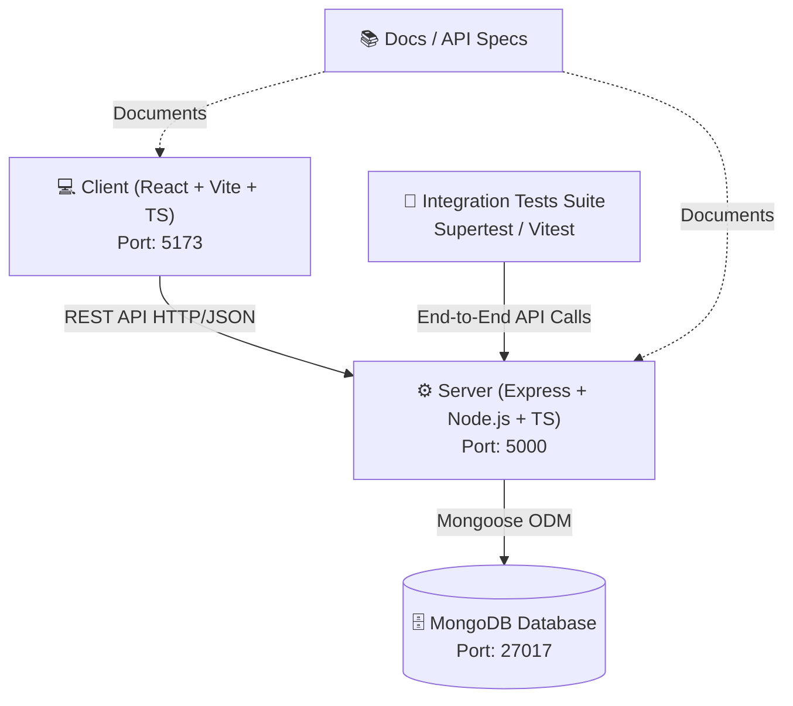

# 🏛️ MERN Stack Monorepo Skeleton

A modular, scalable monorepo architecture for full-stack web applications built with the **MERN** stack (**M**ongoDB, **E**xpress, **R**eact, **N**ode.js) and TypeScript.


## 🏗️ Architectural Overview & Boundaries

This project adopts a **Monorepo architecture with clean layer boundaries** to ensure independent evolution of the frontend, backend, test suites, and documentation while maintaining unified dependency orchestration.



### Boundary Isolation Principles

1. **Client Isolation (`client/`)**:
   - The React frontend is completely decoupled from server implementation details.
   - All server communications flow through an explicit API client service abstraction layer (`src/services/api.ts`).
   - Uses strict TypeScript interfaces matching API DTO contracts.

2. **Server Isolation (`server/`)**:
   - Express REST API with layered architecture: **Routes ➔ Middleware ➔ Controllers ➔ Models (Mongoose)**.
   - Database connection management, input validation, and centralized error handling are fully self-contained.
   - Exposes RESTful endpoints versioned under `/api/v1/`.

3. **Shared Contracts & Type Discipline**:
   - The REST interface uses standardized JSON payloads (`{ success: boolean, data: T, message?: string }`).
   - Client and Server interfaces are aligned for predictable payload exchange.

4. **Integration & E2E Testing Boundary (`test/`)**:
   - Test suites operate as independent consumers against the server endpoints, validating realistic user journeys and contract adherence.

---

## 📂 Monorepo Directory Layout

```text
├── client/                     # Frontend Application (React + Vite + TypeScript)
│   ├── src/
│   │   ├── components/         # Reusable UI Components (ItemForm, ItemList, Header)
│   │   ├── services/           # HTTP API client and resource services
│   │   ├── types/              # TypeScript interface definitions (Item, ApiResponse)
│   │   ├── App.tsx             # Root Application view
│   │   ├── main.tsx            # DOM entrypoint
│   │   └── index.css           # Global modern CSS styling
│   ├── index.html              # HTML entrypoint
│   ├── package.json            # Client dependencies and build scripts
│   ├── tsconfig.json           # Client TypeScript configuration
│   └── vite.config.ts          # Vite bundler & dev server config (proxying to server)
│
├── server/                     # Backend API (Express + Mongoose + TypeScript)
│   ├── src/
│   │   ├── config/             # DB connection (Mongoose) and environment schema
│   │   ├── controllers/        # Request handlers & business logic (ItemController)
│   │   ├── middleware/         # Centralized error handler, 404 handler, logging
│   │   ├── models/             # Mongoose schemas & interfaces (ItemModel)
│   │   ├── routes/             # Express route definitions (/api/v1/items, /api/health)
│   │   ├── app.ts              # Express application setup & middleware assembly
│   │   └── server.ts           # HTTP server bootstrapping & graceful shutdown
│   ├── package.json            # Server dependencies and scripts
│   └── tsconfig.json           # Server TypeScript configuration
│
├── docs/                       # Architecture and API Documentation
│   ├── architecture.md         # Detailed architectural boundaries and data flow
│   ├── api-spec.md             # REST API specifications and contracts
│   └── contributing.md         # Development guidelines and git workflow
│
├── test/                       # Monorepo Integration & E2E Test Suite
│   ├── integration/            # Supertest integration tests for endpoints
│   ├── package.json            # Test suite dependencies & vitest runner
│   └── tsconfig.json           # Test TypeScript configuration
│
├── .env.example                # Global environment template
├── .gitignore                  # Git ignore rules for monorepo
├── package.json                # Root workspaces manifest & orchestrator scripts
└── README.md                   # This architecture document
```

---

## ⚡ First Vertical Feature Slice: Item/Task Management

To demonstrate true full-stack integration across all layers of the monorepo, a complete **Item / Task Management** vertical slice is implemented:

```
[ MongoDB Document ]
        ↕ (Mongoose Schema: item.model.ts)
[ Express Controller & Routes ] (item.controller.ts, item.routes.ts)
        ↕ (HTTP REST API: /api/v1/items)
[ Client API Service Layer ] (itemService.ts, api.ts)
        ↕ (State & Hooks: React useState/useEffect)
[ Client UI Components ] (ItemForm.tsx, ItemList.tsx, App.tsx)
```

### Slice Components

1. **Database Model (`server/src/models/item.model.ts`)**:
   - Attributes: `title` (string, required), `description` (string), `completed` (boolean), `priority` ('low' | 'medium' | 'high'), `timestamps` (`createdAt`, `updatedAt`).

2. **API Endpoints (`server/src/routes/item.routes.ts`)**:
   - `GET /api/v1/items` — Retrieve all items (with optional status filtering).
   - `GET /api/v1/items/:id` — Retrieve item by ID.
   - `POST /api/v1/items` — Create a new item with validation.
   - `PUT /api/v1/items/:id` — Update item details / toggle completion.
   - `DELETE /api/v1/items/:id` — Remove an item.

3. **Frontend Service (`client/src/services/itemService.ts`)**:
   - Encapsulates network operations using typed responses.

4. **Interactive UI (`client/src/components/`)**:
   - Form creation with priority and validation.
   - Filterable item list with status badges and deletion actions.

---

## 🚀 Prerequisites & Local Setup

### Prerequisites
- **Node.js**: v18.0.0 or higher (v20+ recommended)
- **npm**: v9.0.0 or higher (supports npm workspaces)
- **MongoDB**: Local MongoDB instance running on `mongodb://localhost:27017` OR a MongoDB Atlas connection string.

### Step-by-Step Installation

1. **Clone the repository:**
   ```bash
   git clone <repository-url>
   cd monorepo
   ```

2. **Install all dependencies across the monorepo:**
   ```bash
   npm install
   ```
   *(This uses npm workspaces to resolve and link dependencies for root, client, server, and test in one step).*

3. **Configure Environment Variables:**
   ```bash
   # Create server environment file
   cp server/.env.example server/.env

   # (Optional) Adjust MONGO_URI or PORT in server/.env if needed
   ```

4. **Start MongoDB (if running locally):**
   ```bash
   # Ensure your mongod service is running
   mongod
   ```

5. **Run the Development Environment:**
   ```bash
   npm run dev
   ```
   This concurrently starts:
   - **Backend Server** at `http://localhost:5000` (with live reload via `tsx`)
   - **Frontend Client** at `http://localhost:5173` (with Vite HMR)

---

## ⚙️ Environment Variables

### Server (`server/.env`)
| Variable | Description | Default |
| :--- | :--- | :--- |
| `PORT` | Port for the Express server | `5000` |
| `NODE_ENV` | Environment mode (`development` / `production` / `test`) | `development` |
| `MONGO_URI` | MongoDB connection URI string | `mongodb://localhost:27017/mern_monorepo_dev` |
| `CLIENT_ORIGIN` | Allowed CORS origin for frontend | `http://localhost:5173` |

### Client (`client/.env`)
| Variable | Description | Default |
| :--- | :--- | :--- |
| `VITE_API_URL` | Base URL for Express REST API | `http://localhost:5000/api/v1` |

---

## 📜 Available Scripts

From the repository root:

| Command | Description |
| :--- | :--- |
| `npm run dev` | Starts both server and client concurrently in development mode |
| `npm run dev:server` | Starts only the Express server with live reload (`tsx watch`) |
| `npm run dev:client` | Starts only the Vite React development server |
| `npm run build` | Compiles both server (TypeScript to JS) and client (Vite bundle) |
| `npm run build:server` | Builds the server TypeScript source into `server/dist` |
| `npm run build:client` | Builds the React frontend into `client/dist` |
| `npm test` | Runs all automated integration tests |
| `npm run typecheck` | Validates TypeScript types across all workspaces |
| `npm run clean` | Removes all `node_modules` and build directories for a fresh install |

---

## 🧪 Testing Strategy

The `test/` workspace contains automated integration tests leveraging **Supertest** and **Vitest** to validate the HTTP layer and database integrations without requiring a live browser.

To run tests:
```bash
npm test
```

---

## 📚 Documentation Index

- [Architecture & Boundaries Guide](docs/architecture.md)
- [REST API Specification](docs/api-spec.md)
- [Contributing & Development Guidelines](docs/contributing.md)
